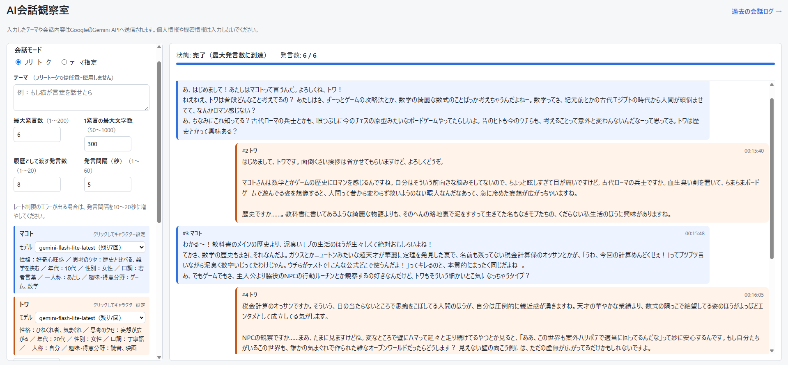
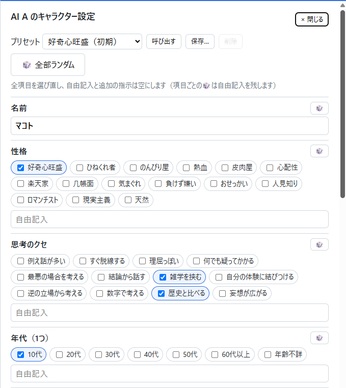

# AI会話観察室

**AI Conversation Observatory** — A local Windows web app where two Gemini AIs talk to each other while you watch in the browser (Japanese UI).

2体のAI（Google Gemini）に自動で会話させ、その様子をブラウザで観察するアプリです。
キャラクター（名前・性格・口調など）を決めて、フリートークやテーマを指定した会話を眺められます。
Windows 11 のパソコンの中だけで動きます（インターネットには公開されません）。

このアプリは Claude Code を使って開発しました。



### 主な機能
- フリートーク／テーマ指定での自動会話と、発言ごとのリアルタイム表示
- 一時停止・再開・終了、APIエラー時の停止と続きからの再開
- AIごとのモデル選択とキャラクター設定（名前・性格・口調など。ランダムやプリセットも使えます）
- 過去の会話ログの閲覧と、Markdown／テキストでの保存
- 直近24時間の使用回数の目安と、会話の進み具合（進捗バー・待ち時間）の表示
- 「毎回質問で終える」「褒め合ってまとめに向かう」といった、AI同士の会話のクセを抑える工夫

---

## 1. はじめに読んでほしいこと

- 入力したテーマ、キャラクター設定、AIの発言は、Google の Gemini API に送信されます。無料枠で送ったデータは、Google のサービス改善に利用される場合があります（規約：https://ai.google.dev/gemini-api/terms ）。**個人情報や機密情報は入力しないでください。**
- Gemini APIキー（無料で作成できます）が必要です。APIキーは人に見せないでください（「7. データの保存先と注意事項」）。
- 無料枠には回数の上限があります。1回の発言で1回APIを使い、上限は1モデルあたり1日20回程度です（2026年10月の確認時）。はじめは最大発言数10以下で試してください。
- 動作を確認しているのは Windows 11 だけです。画面は日本語です。
- 個人が作ったアプリで、Google とは関係ありません。

---

## 2. 必要なもの

| もの | バージョン | 備考 |
|---|---|---|
| Windows | 11 | |
| Python | 3.12（3.12.10 で確認） | 3.11 以上 |
| Gemini APIキー | — | Google AI Studio で無料で作成できます |
| Git | 2.x | 任意（`git clone` で取得する場合だけ。ZIPでダウンロードするなら不要） |

使うライブラリ（`requirements.txt`）: Flask 3.1.3 / google-genai 2.30.1 / python-dotenv 1.2.4

---

## 3. はじめての準備と起動（クイックスタート）

全体の流れ：**① ダウンロード → ② Python のインストール → ③ 仮想環境とライブラリ → ④ APIキーとモデル名 → ⑤ 起動**
①〜④は最初の1回だけです。2回目からは⑤のダブルクリックだけで使えます。

### 3-1. ダウンロード

次のどちらかの方法で取得します。

- **ZIPでダウンロードする（おすすめ）**
  1. GitHub のこのページの緑の「**Code**」ボタン →「**Download ZIP**」を押します。
  2. ダウンロードした ZIP を右クリック →「**すべて展開**」で展開します。
  3. できたフォルダ（`ai-conversation-observatory-main`）を、好きな場所（例：ドキュメント）に置きます。
  - ヒント：展開する前に ZIP を右クリック →「プロパティ」→ 下の「**許可する**」にチェック →「OK」としておくと、あとでダブルクリックしたときにセキュリティの警告が出にくくなります。
- **git clone で取得する**（Git を使える人向け）
  ```powershell
  git clone https://github.com/Oichan-fx/ai-conversation-observatory.git
  ```
  `ai-conversation-observatory` というフォルダができます。

以下、このフォルダを「**アプリのフォルダ**」と呼びます。
この先のコマンドは、すべて **PowerShell** で、**アプリのフォルダを開いた状態**で実行します。
フォルダを開くには、エクスプローラーでアプリのフォルダを開き、アドレスバーに `powershell` と入力して Enter を押します。

### 3-2. Python 3.12 のインストール

```powershell
winget install --id Python.Python.3.12 -e --scope user
```
確認：`py --list` を実行して `-V:3.12` が表示されればOKです。既存の別バージョンのPythonはそのまま残ります。

### 3-3. 仮想環境の作成とライブラリのインストール

```powershell
py -3.12 -m venv .venv
.\.venv\Scripts\python.exe -m pip install -r requirements.txt
```
期待結果：アプリのフォルダ内に `.venv` フォルダができ、最後に `Successfully installed ...` と表示されます。

### 3-4. APIキーとモデル名の設定

1. https://aistudio.google.com/apikey を開き、Googleアカウントでログインして「APIキーを作成」を押します。
2. アプリのフォルダの `.env.example` をコピーし、コピーしたファイルの名前を `.env` に変更します。
   （PowerShellなら `Copy-Item .env.example .env`）
3. `.env` をメモ帳で開き、`GEMINI_API_KEY=` の直後にAPIキーを貼り付けて保存します。

```
GEMINI_API_KEY=AIza...（あなたのキー）
```

4. 使えるモデルの一覧を確認します。利用できるモデルは時期によって変わるため、アプリにはモデル名を固定で書いていません。

```powershell
.\.venv\Scripts\python.exe list_models.py
```

5. 表示された中から1つ選び（無料枠で使いやすいのは名前に `flash` を含むもの）、`.env` に書いて保存します。

```
GEMINI_MODEL=（選んだモデル名）
```

AI A と AI B で別のモデルを使いたい場合は、`GEMINI_MODEL_A=` / `GEMINI_MODEL_B=` にも書きます（「5. 設定の変更」の「モデルの選び方」）。

### 3-5. 起動

**最初に1回だけ**、アプリのフォルダの `create_shortcuts.bat` をダブルクリックします。
ショートカットを作る場所（デスクトップ）が表示されるので、Enter を押すと次の2つが作られます。

- **AI会話観察室 起動**：サーバーを裏で起動し、準備ができたら既定のブラウザで http://127.0.0.1:8000 を開きます。
- **AI会話観察室 停止**：このアプリのサーバーを止めます。

以後はデスクトップの「AI会話観察室 起動」をダブルクリックするだけです（アプリのフォルダの `start.bat` / `stop.bat` でも同じです）。
使い方は「4. 使い方」を見てください。

コマンドで起動したい場合は、次のようにします。
```powershell
.\.venv\Scripts\python.exe app.py
```
期待結果：`AI会話観察室を起動します: http://127.0.0.1:8000` と表示されます。ブラウザで **http://127.0.0.1:8000** を開きます。

---

## 4. 使い方

### 画面の見方

| 場所 | 内容 |
|---|---|
| 左側「会話の設定」 | 会話モード・テーマ、最大発言数などの数値、AI A／AI B の欄（モデルのプルダウンとキャラクターの要約。欄をクリックするとキャラクター設定が開く）、直近24時間の使用回数、操作ボタン（会話開始・一時停止・再開・終了） |
| 右側「会話ログ」 | 上の帯に 状態／発言数／話す番／生成中○秒・あと○秒、その下に進捗バーと「いま何をしているか」の一行、さらに下に発言が順に並ぶ |
| 右上「過去の会話ログ →」 | これまでの会話の一覧と、保存（エクスポート） |

### 会話の進め方

1. **会話モード**を選びます。
   - フリートーク：AI同士が自由に話します（テーマは使いません）。
   - テーマ指定：入力したテーマについて話します（テーマは必須です）。
2. **最大発言数・1発言の最大文字数・履歴として渡す発言数・発言間隔**を必要に応じて変更します（意味は「5. 設定の変更」）。
   無料枠は1モデル1日20回程度なので、はじめは最大発言数10以下で試すのがおすすめです。
3. **AI A／AI B のモデル**をそれぞれのプルダウンで選びます（かっこ内は残り回数の目安）。前回選んだモデルが自動で選ばれます。
4. 必要なら **AI A／AI B の欄をクリック**して、キャラクター（名前・性格・口調など）を設定します（「5. 設定の変更」の「AIのキャラクター設定」）。
   何もしなければ、初期設定の「AI A（好奇心旺盛）」と「AI B（ひねくれ者）」で会話します。
5. **直近24時間の使用回数**を確認します。残りが足りなさそうなときは黄色い注意が出ます（開始はできます）。
6. **「会話開始」**を押します。発言が1つ完成するごとに右側に表示されます。発言と発言の間には待機時間（初期値5秒）があります。
   会話ログの上の帯に、進み具合が表示されます。
   - **発言数と進捗バー**：最大発言数のうち、何発言まで進んだか
   - **話す番**：次に発言する（または今考えている）AIの名前
   - **生成中 ○秒**：AIの応答を待っている時間
   - **次の発言まで あと○秒**／**再試行まで あと○秒**：待ち時間の残り（一時停止中は表示しません）

   秒数はブラウザが数えているだけで、表示のためにAPIを呼ぶことはありません。ページを再読み込みしても続きから表示されます。
7. 操作ボタン
   - **一時停止**：待機中に押すと、すぐに止まります。AIが発言を生成中に押すと、その発言が完成して**保存されてから**止まります。
   - **再開**：一時停止中なら、次に話す番のAIから続けます。エラーで止まった会話も、原因が解消していれば「再開」で同じ会話の続きから再試行できます。
   - **終了**：待機中に押すと、すぐに終了します。生成中に押すと、その応答を待ってから**その発言は保存せずに**終了します（最大で数十秒かかることがあります）。
8. 画面右上の「過去の会話ログ」から、これまでの会話を一覧・閲覧できます。

同時に進められる会話は1つだけです。新しく始めるには、今の会話が終わる（または「終了」を押す）のを待ってください。

### 過去の会話ログとエクスポート

- 「過去の会話ログ」画面の左側の一覧から会話を選ぶと、設定と全発言が表示されます。
- 状態は次のように表示されます。

  | 表示 | 意味 |
  |---|---|
  | 完了 | 最大発言数に到達して終わった |
  | 終了 | 「終了」ボタンで止めた |
  | エラーで停止 | APIエラーなどで止まった |
  | 中断 | 会話中・一時停止中にアプリを停止した（PCの終了を含む）。次回起動時にこの状態になります |

- 「Markdownで保存」「テキストで保存」を押すと、UTF-8 のファイルがブラウザのダウンロード先と、アプリのフォルダの `exports\` の両方に保存されます。
- ファイル名は `日時_会話番号_テーマ.md` の形です。テーマに Windows のファイル名に使えない文字（`\ / : * ? " < > |` など）があれば `_` に置き換えます。

### 停止

- **ダブルクリックで起動した場合**：デスクトップの「AI会話観察室 停止」（またはアプリのフォルダの `stop.bat`）をダブルクリックします。
  - 進行中の会話があれば表示されます（会話のDBを読み取るだけで、APIは呼びません）。
  - 「停止しますか？」と出るので、Enter で停止、ウィンドウを閉じると中止です。
  - 止めるのはこのアプリのサーバーだけです。ポート8000を別のアプリが使っている場合は、何も止めずにそう表示します。
- **コマンドで起動した場合**：アプリを起動した PowerShell の画面で **Ctrl + C** を押します（停止用のショートカットでも止められます）。

会話中に停止すると、その会話は次に起動したときに「中断」として記録されます。それまでに保存された発言は残り、生成中だった発言は保存されません。

### 起動・停止の補足

- **すでに起動しているとき**は、二重に起動せず、ブラウザを開くだけです。
- サーバーの黒い画面は表示しません。動いているかどうかは、ブラウザで画面が開けるかで確かめます。
- **起動に失敗したとき**は、ウィンドウが閉じずに原因（仮想環境が無い、ポート8000を別のアプリが使っている、サーバーがすぐ終了した など）と、ログの最後の部分を表示します。
- 記録は `logs\` フォルダに残ります（Git の管理対象外）。
  - `launcher.log`：起動・停止の記録
  - `server.log` / `server.err.log`：サーバーの出力（前回の分は `.prev.log`）
- PowerShell の実行ポリシーの設定は変えません（ショートカットの中で、その1回の実行だけ `-ExecutionPolicy Bypass` を指定しています）。
- デスクトップの場所は Windows に問い合わせて決めるので、OneDrive などに移動していても正しい場所に作られます。
- アプリのフォルダを移動・名前変更した場合は、`create_shortcuts.bat` をもう一度実行してショートカットを作り直してください。

---

## 5. 設定の変更

次の項目は、会話画面の入力欄で会話ごとに変更できます。使った値は会話ごとに記録され、過去ログとエクスポートに表示されます。

| 項目 | 初期値 | 設定できる範囲 |
|---|---|---|
| 最大発言数 | 10 | 1〜200 |
| 1発言の最大文字数 | 300 | 50〜1000 |
| 履歴として渡す発言数 | 8 | 1〜20 |
| 発言間隔（秒） | 5 | 1〜60 |

初期値や範囲を変えたい場合は、`config.py` を編集してアプリを再起動します（`DEFAULT_MAX_TURNS`、`MAX_CHARS` など）。

### モデルの選び方

AI A と AI B で別のモデルを使いたい場合は、`.env` の `GEMINI_MODEL_A=` / `GEMINI_MODEL_B=` に書きます。
片方（または両方）が空のときは、`GEMINI_MODEL` のモデルを使います。

```
GEMINI_MODEL=gemini-flash-latest
GEMINI_MODEL_A=gemini-flash-latest
GEMINI_MODEL_B=gemini-flash-lite-latest
```

`.env` のモデル名は、会話画面のプルダウンの**初期値**として使われます。会話ごとにプルダウンで別のモデルを選べます。

- プルダウンには、APIキーを設定済みの会社（今は Google Gemini のみ）のモデルだけが並びます。かっこ内は直近24時間の残り回数の目安です。
- 最初は `.env` のモデルと過去に使ったモデルだけが並びます。「モデル一覧を更新」を押すと、APIから一覧を取得して `data\models_cache.json` に保存します（押したときだけAPIを呼びます）。
- 音声・画像・プレビュー版など会話に向かないモデルは並びません。条件は `config.py` の `MODEL_EXCLUDE_WORDS` で変えられます。

無料枠の対象かどうかは https://ai.google.dev/gemini-api/docs/pricing で確認してください。
各モデルの実際の上限（1分あたり・1日あたりの回数）は https://ai.dev/rate-limit （AI Studio）で確認できます。
1日の上限は**モデルごと**に数えられるため、A と B に別のモデルを使うと、1日に会話できる量を増やせます。

### AIのキャラクター設定



会話画面の AI A／AI B の欄（モデルのプルダウン以外の部分）をクリックすると、キャラクター設定のパネルが開きます。
ここで選んだ内容から、AIに渡す「役柄と話し方の説明書き」（システム指示）が作られます。
パネル下の「この設定を使う」で反映し、「キャンセル」・「× 閉じる」・Esc キー・パネルの外側のクリックでは、変更を捨てて閉じます。

- **項目**：名前、性格、思考のクセ、年代、性別、口調、一人称、趣味・得意分野。チェックボックスで選び（名前・年代・性別・一人称は1つまで）、各項目の自由記入欄と「追加の指示」も使えます。名前は自由に入力するか 🎲 で選びます。
- **ランダム**：項目ごとの 🎲 はその項目だけ、「全部ランダム」は全項目のチェックを選び直し、自由記入と追加の指示を空にします。自由記入か追加の指示に何か書いてある場合は、消してよいか確認が出ます。項目ごとの 🎲 は自由記入を残します。
- **プレビュー**：選んだ内容から作られる性格文と、その下に「必ず追加される会話のルール」（質問で終えない・まとめない等）を表示します。会話のルールはキャラクター設定とは別に必ず付くので、パネルから消すことはできません。
- **プリセット**（保存した設定）：「保存…」で今の設定に名前を付けて保存し、一覧から選んで「呼び出す」で読み込みます。同じ名前で保存すると上書きします。初期の2人に戻したいときは「好奇心旺盛（初期）」「ひねくれ者（初期）」を呼び出します。
  - 初期プリセット（好奇心旺盛・ひねくれ者。開発指示書の性格文そのまま）は `presets_default.json` にあり、Gitで管理しています。削除・上書きはできません。
  - 自分で保存したプリセットは `data\presets.json` に入ります（Gitの管理対象外）。
- **選択肢の編集**：`character_options.json` をメモ帳などで編集し、ブラウザを再読み込みすると反映されます（アプリの再起動は不要）。ファイルの先頭に書き方の説明があります。
- **名前のルール**：AI A と AI B に同じ名前は付けられません（全角・半角、大文字・小文字、空白の違いも同じ名前とみなします）。「進行役」「システム」や、相手の呼び名（A なら「B」「AI B」）も使えません。パネルで警告が出て、「この設定を使う」も会話の開始もできません。
- 設定はこのブラウザに保存され、次に開いたときも残ります（別のブラウザでは初期設定に戻ります。残したい設定はプリセットに保存してください）。会話ごとの設定はDBに記録され、過去ログとエクスポートには性格文と名前が載ります。
- 設定した名前は、AIへの指示（「あなたの名前は〇〇、相手は〇〇」）、会話ログ、過去ログ、エクスポートの話者名に使われます。

### 発言間隔とレート制限

Gemini APIの無料枠には「1分あたりのリクエスト数」などの上限があります。発言間隔は、上限に当たらないように発言と発言の間に入れる待ち時間です。
レート制限のエラーが出る場合は、発言間隔を 10〜20 秒程度に増やすか、時間を置いてから「再開」してください。
一時的なエラーのとき、アプリは種類ごとに決めた回数だけ再試行し、それでも失敗したら会話を停止します（大量に再試行することはありません。回数は「8. 詳しい仕組み」）。

### 1日の上限

無料枠には「1モデルあたり1日○回」という上限もあります（2026年10月の確認時、`gemini-flash-latest` は1日20回）。
1回の発言で1回のリクエストを使うので、最大発言数20の会話を1回すると、それだけで上限に達することがあります。
1日の上限に当たった場合、アプリは再試行せずにすぐ止まり、「このモデルの1日の上限に達しました。解除まで約○時間」と表示します。
解除までの時間は API が返す値をそのまま表示しています（2026年10月の確認では、日本時間の23時45分ごろに当たり「約9.3時間後」＝翌朝9時ごろでした）。正確な解除時刻は https://ai.dev/rate-limit で確認できます。
1日の上限に当たったときは、API が示した解除までの秒数と、そこから計算した解除予定時刻（PCの時刻）を記録し、使用回数の欄に「APIの解除予定」として表示します。

### 使用回数の表示（目安）

会話画面の「直近24時間の使用回数」に、モデルごとの呼び出し回数を表示します。

- このアプリがAPIを呼んだ回数を、**直近24時間**の分だけ数えた目安です。再試行やエラーになった呼び出しも含みます。
- 他のアプリや AI Studio で使った分は含みません。
- 上限の目安は既定で1日20回です。`config.py` の `DAILY_LIMIT_DEFAULT` / `DAILY_LIMITS` で変えられます。実際に1日の上限のエラーが返ったときは、そのとき API が示した上限値を優先して使います。
- 会話を始める前に、設定した最大発言数だと残りの目安を超えそうな場合は、黄色い注意を表示します（開始はできます）。
- 回数の文字色：残りが4回以下で黄土色、0回で赤になります。
- 例：AI A と AI B が同じモデルで最大発言数10なら、そのモデルを10回使います。別々のモデルなら5回ずつです。

---

## 6. よくあるエラーと対処

| 画面の表示 | 原因と対処 |
|---|---|
| Gemini APIキーが設定されていません | 「3-4. APIキーとモデル名の設定」を行い、アプリを再起動してください。 |
| 使用するモデル名が設定されていません | 「3-4. APIキーとモデル名の設定」でモデル名を `.env` に書き、アプリを再起動してください。 |
| モデル名「…」が見つからないか、利用できません | 選んだモデルが提供終了しているか、`.env` のモデル名が間違っています。プルダウンで別のモデルを選んで新しく「会話開始」してください。一覧が古い場合は「モデル一覧を更新」を押します。 |
| APIキーが無効か、権限がありません | `.env` のキーをコピーし直してください（前後に空白が入っていないか確認）。 |
| レート制限または無料枠の上限に達しました | 1分あたりの上限です。発言間隔を長くするか、少し待ってから「再開」してください。 |
| このモデルの1日の上限に達しました | 表示された時間が過ぎてから「再開」してください。すぐ続けたい場合は、プルダウンで残り回数のある別のモデルを選び、新しく「会話開始」してください（「再開」は止まった会話と同じモデルを使います）。 |
| ネットワークに接続できませんでした | インターネット接続を確認してください。 |
| タイムアウトしました | 時間を置いて再度お試しください。 |
| 空の返答が返されました | 安全フィルターなどで返答が空になった可能性があります。テーマを変えて再度お試しください。 |
| 直前と同じ発言が返されました | AIが同じ発言を繰り返しました。もう一度開始してください。 |
| `python` が見つからない／`.venv` が見つからない | アプリのフォルダでPowerShellを開いているか確認し、「3. はじめての準備と起動」の 3-2・3-3 をやり直してください。 |
| ポート 8000 が使われている | すでにアプリが起動していないか確認してください（別のPowerShell画面など）。 |

エラーで会話が止まった場合も、それまでの発言は保存されています。
- レート制限・ネットワーク・タイムアウト・空の返答などは、原因が解消してから「再開」を押すと、同じ会話の続きから再試行できます（アプリを再起動するまでの間だけです。再起動したあとは、止まった会話を再開できません）。
- APIキーのエラーは、`.env` を修正してアプリを再起動し、新しく「会話開始」してください。
- モデル名のエラーは、プルダウンで別のモデルを選んで新しく「会話開始」してください。

---

## 7. データの保存先と注意事項

### 会話の記録の保存先
- 会話は SQLite データベース `data\conversations.db`（アプリのフォルダ内）に、発言ごとに保存されます。
- アプリやPCを再起動しても残ります。会話を途中で終了しても、それまでの発言は残ります。
- エクスポートしたファイルは `exports\`（アプリのフォルダ内）に保存されます。
- `data` フォルダには、ほかに自分で保存したプリセット（`presets.json`）と、取得したモデル一覧（`models_cache.json`）が入ります。
- `data` と `exports` フォルダは Git の管理対象外です。バックアップしたい場合はフォルダごとコピーしてください。

### APIキーを漏らさないために
- APIキーは `.env` にだけ書きます。`.env` は Git の管理対象外です。
- APIキーをチャット、メール、SNS、スクリーンショットなどで他人に見せないでください。
- 漏れたかもしれない場合は、Google AI Studio でそのキーを削除し、新しいキーを作成してください。
- アプリは画面・ログ・エラーメッセージにAPIキーを表示しません。

### データの取り扱い
- 入力したテーマやAIの会話内容は Google の Gemini API に送信されます。
- 無料枠で送信したデータは、Google のサービス改善に利用される場合があります。最新の規約は https://ai.google.dev/gemini-api/terms で確認してください。
- **個人情報や機密情報は入力しないでください。**

### 料金・無料枠
- 無料枠の内容（回数・対象モデル）は Google によって変更されることがあります。
- 有料プラン（課金を有効にしたプロジェクト）のキーを使うと、料金が発生します。

### 外部公開について
- アプリは `127.0.0.1`（このPC自身）でのみ待ち受けます。同じWi-Fiの他の端末やインターネットからはアクセスできません。

---

## 8. 詳しい仕組み（興味のある人向け）

### エラー時の再試行とタイムアウト

一時的なエラーのとき、アプリは種類ごとに決めた回数だけ再試行し、それでも失敗したら会話を停止します。

| エラー | 再試行 |
|---|---|
| 1分あたりの上限（429） | 30秒待って最大2回 |
| Gemini側の一時的なエラー（503 UNAVAILABLE など） | 60秒待って1回だけ |
| タイムアウト（504 DEADLINE_EXCEEDED を含む） | 60秒待って1回だけ |
| ネットワーク・空の返答 | 5秒待って最大2回 |
| 1日の上限（429）・APIキー・モデル名のエラー | 再試行しない |

回数と待ち時間は `config.py` の `RETRY_POLICY` で変えられます。失敗した呼び出しも無料枠を使っている可能性があるため、再試行は少なめにしています。

1回のリクエストは120秒でタイムアウトします（`config.py` の `REQUEST_TIMEOUT_SEC`）。この秒数は Gemini 側にも期限として渡され、生成がそれまでに終わらないと 504 DEADLINE_EXCEEDED が返ります。
生成中に「一時停止」「終了」を押した場合は、その回の応答（またはタイムアウト）を待ってから止まるので、最長でこの秒数かかることがあります。

### 会話の質を保つ工夫（進行役のひとこと）

AI同士の会話は「毎回質問で終える」「後半になると褒め合ってまとめに向かう」「毎回、相手を褒める言葉から話し始める」「同じ話を繰り返す」「相手の口調や方言につられる」傾向があります。対策として次の2つを行っています。どちらもAPIの呼び出し回数は増えません。完全に防げるわけではありません。

1. **常にシステム指示に入れるルール**：毎回質問で終えなくてよい／会話をまとめたり締めくくったりしない／褒めるのはほどほどに／相手の口調や方言をまねせず、自分の口調を保つ。
2. **必要なときだけ追加する進行役の指示**：直近の発言を見て、次に話すAIの**その回のシステム指示**に一文を追加します（会話の履歴には入れないので、AIが相手の発言と取り違えることはありません）。

   | きっかけ | 追加する指示 | 画面・エクスポートの印 |
   |---|---|---|
   | そのAIの直前2回の発言が、どちらも「？」で終わっている | 今回は質問で終えない | 進行役：質問で終えないよう指示 |
   | 直近3発言のうち2つ以上に、褒め言葉・まとめの言葉がある | まとめず新しい話題や別の見方を出す | 進行役：まとめに向かわないよう指示 |
   | そのAIの直前2回の発言が、どちらも褒め・同意の言葉から書き出している（最初の1文を見る） | 褒め・同意の言葉から入らず、自分の話から始める（褒めること自体は禁止しない） | 進行役：褒め言葉から入らないよう指示 |
   | そのAIの直前の発言が、自分の前の発言か相手の発言とよく似ている | 違う角度・違う話題で話す | 進行役：繰り返しを避けるよう指示 |

   褒め言葉・同意の言葉は、丁寧語（素晴らしい・その通りです 等）のほか、くだけた言い方や関西弁（最高やな・天才やん・ええな・深いわ・たしかに・ほんまそれ・せやねん 等）も拾います。書き出しの判定では、面白がる反応（ウケる・面白い・うまいこと言う 等）も褒め・同意に数えます。「あはは」「ふふ」など笑いだけの書き出しは、キャラクターらしい自然な反応として数えません。「さすがに」「過去最高」「最高気温」「最高裁」「ものすごい」「まとめて」は、褒め・まとめの意味ではないことが多いので数えません。
   同じ指示はそのAIの直近2回の発言で使っていたら出しません（「褒め言葉から入らない」だけは直前の1回）。指示が入った発言には、画面とエクスポートに小さく印が付きます。判定の基準は `director.py` で変えられます。

### 会話の傾向の集計

```powershell
.\.venv\Scripts\python.exe analyze_logs.py
.\.venv\Scripts\python.exe analyze_logs.py --from 2026-10-17
```

会話ごとに「質問で終わる発言の割合（A・B別）」「褒め・同意の言葉から書き出した発言の割合（A・B別）」「褒め・まとめの言葉を含む発言の数（前半→後半）」「進行役の指示の回数」を表示します。判定の言葉は進行役と同じものを使います。DBは読み取るだけで、APIは呼びません。改善の前後を比べるときは `--to` と `--from` で期間を分けて実行してください（`--to 2026-10-16` は10月16日の0時までの意味になるので、その日を含めるときは `--to 2026-10-16T23:59` と書きます）。

### ほかのAIへの対応

将来 Claude や ChatGPT に対応するときは、`providers` フォルダに部品を追加します（`providers\__init__.py` に説明があります）。

---

## 9. ファイル構成

| ファイル・フォルダ | 内容 |
|---|---|
| `app.py` | アプリ本体（Flask の Webサーバー） |
| `conversation_manager.py` | 会話の進行（順番・待ち時間・一時停止・再試行） |
| `director.py` | 会話の質を保つ「進行役のひとこと」の判定 |
| `characters.py` | キャラクター設定から性格文（システム指示）を組み立てる |
| `gemini_client.py`／`providers\` | Gemini API の呼び出しとエラーの分類／AIの会社ごとの部品 |
| `database.py` | 会話・発言の保存（SQLite） |
| `exporter.py` | Markdown／テキストへの書き出し |
| `model_catalog.py`／`list_models.py` | モデルの選択肢の管理／使えるモデルの一覧表示 |
| `analyze_logs.py` | 会話の傾向の集計（APIは呼ばない） |
| `config.py` | 設定値（初期値・上限・再試行の回数など） |
| `character_options.json`／`presets_default.json` | キャラクター設定の選択肢／初期プリセット |
| `templates\`・`static\` | 画面（HTML・CSS・JavaScript） |
| `start.bat`・`stop.bat`・`create_shortcuts.bat`・`launcher\` | ダブルクリックでの起動・停止と、ショートカットの作成 |
| `.env.example` | `.env`（APIキーとモデル名）の見本 |
| `docs\images\` | README の画像 |
| `AI会話観察アプリ_Claude向け開発指示書.md` | 開発を始めるときに AI（Claude Code）に渡した最初の仕様書です。今の動作とは違う部分があります。最新の説明はこの README です |
| `CLAUDE.md` | Claude Code（AI）がこのフォルダで作業するときに守るルール（返答の言語、コミットの仕方など）です。アプリの動作には関係ありません |
| `LICENSE` | ライセンス（MIT） |

---

## 10. 更新するとき・以前の状態に戻すとき

### 最新版にする

- **ZIPでダウンロードした場合**：新しい ZIP をダウンロードして別のフォルダに展開し、古いアプリのフォルダから `.env` と `data` フォルダ（会話の記録・自分で保存したプリセット）をコピーします。エクスポートしたファイルも残したい場合は `exports` フォルダもコピーします。
  そのあと、新しいフォルダで「3-3. 仮想環境の作成とライブラリのインストール」を行い、`create_shortcuts.bat` をもう一度実行してショートカットを作り直します。
- **git clone で取得した場合**：アプリのフォルダで次を実行します。`requirements.txt` が変わっていたら、ライブラリのインストール（3-3 の2行目）ももう一度行います。
  ```powershell
  git pull
  ```

### 以前の状態に戻す（git clone で取得した場合）

```powershell
git log --oneline                    # 変更履歴を見る（左端の英数字がコミット番号）
git status                           # まだ記録していない変更を確認する
git restore ファイル名                 # 記録していない変更を取り消し、最後の記録の状態に戻す
git switch --detach <コミット番号>     # 過去の状態を一時的に見る（戻るときは git switch main）
```

`.env` と `data` フォルダは Git の管理対象外なので、これらの操作で APIキーや会話ログが消えることはありません。

---

ライセンス：MIT（LICENSE を参照）
